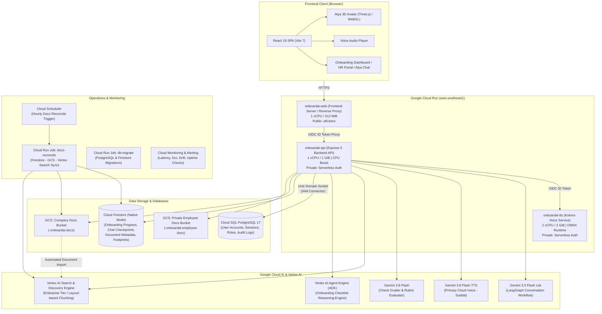

# UniVRse OnboardAi

Onboard.AI turns a new hire’s first-day confusion into a guided journey with Alya, an animated AI onboarding buddy. Combining conversational support with clear visual explanations, Alya helps employees understand company policies, complete essential tasks and find the people and tools they need, while giving HR a clearer view of progress.

Designed for different minds and learning needs, Onboard.AI brings neurodivergent-inclusive onboarding, optional workplace-support preferences and AI-readiness self-assessment into one experience. Employees control what support information they share, while five weighted progress areas make their next steps clear. Our goal: less repetitive work for HR and a more confident, supported start for every new hire.

Built on **Node.js 22, Express 5, React 19, Vite 7, LangGraph, Google Gemini, Terraform, and Google Cloud Run**.

---

## Table of Contents

- [System Architecture](#system-architecture)
  - [Architecture Diagram](#architecture-diagram)
  - [GCP Infrastructure Components](#gcp-infrastructure-components)
  - [Backend Services & Pipelines](#backend-services--pipelines)
- [Key Features](#key-features)
- [Quick Start & Local Development](#quick-start--local-development)
  - [Prerequisites](#prerequisites)
  - [Option A: Local Development Server](#option-a-local-development-server)
  - [Option B: One-Command Docker Stack](#option-b-one-command-docker-stack)
  - [Option C: UI Preview Mode (No Sign-In Required)](#option-c-ui-preview-mode-no-sign-in-required)
  - [Running Tests & Quality Checks](#running-tests--quality-checks)
- [Application Pages & Routes](#application-pages--routes)
- [Environment Configuration](#environment-configuration)
- [Company Knowledge & Document Retrieval](#company-knowledge--document-retrieval)
  - [Dual-Bucket Architecture & Allowlist Filter](#dual-bucket-architecture--allowlist-filter)
  - [Document Reconciliation Job](#document-reconciliation-job)
- [Voice Synthesis Engine](#voice-synthesis-engine)
- [Security & IAM Architecture](#security--iam-architecture)
- [CI/CD & Environments](#cicd--environments)
  - [Staging vs. Production Matrix](#staging-vs-production-matrix)
  - [Release Workflow](#release-workflow)
- [Project Documentation](#project-documentation)

---

## System Architecture

### Architecture Diagram



### GCP Infrastructure Components

The entire infrastructure is managed via **Terraform** (`terraform/onboardai/`) across Staging and Production:

1. **Cloud Run Microservices (`asia-southeast1`, Gen2 execution environment)**:
   - **`onboardai-web`**: The public entry point serving the Vite production build and reverse-proxying API calls. Automatically mints Google-signed OIDC ID tokens via the GCP metadata server to authorize requests to downstream services.
   - **`onboardai-api`**: Private microservice hosting the Express 5 application, Gemini LangGraph workflows, verification grader, and database integrations.
   - **`onboardai-tts`**: Private microservice running the Kokoro TTS engine on ONNX Runtime with concurrency controls (max 8 concurrent voice renders; 9th returns `VOICE_BUSY`).
2. **Cloud SQL PostgreSQL 17**:
   - Enterprise tier database managing credentials, authentication states, department structures, and account audit logs.
   - Accessible strictly via Cloud Run's native Unix domain socket connector (`/cloudsql/<connection_name>`) with `ENCRYPTED_ONLY` SSL enforcement and no public IP exposure.
   - Database credentials are generated dynamically via Terraform `password_wo` and managed in **Secret Manager**, never appearing in `.tfstate`.
3. **Cloud Firestore (Native Mode)**:
   - Production database `(default)` and Staging database `onboardai-staging` in `asia-southeast1`.
   - Stores employee onboarding progress, task verification records, chat session states, LangGraph checkpoints, and company document metadata.
   - Includes automatic TTL expiration policies (e.g., `purgeAt` on `employeeImports`).
4. **Cloud Storage Buckets**:
   - **Company Documents Bucket (`<project>-onboardai-docs`)**: Stores approved organizational policies, SOPs, and handbooks indexed by Vertex AI Search.
   - **Employee Submissions Bucket (`<project>-onboardai-employee-docs`)**: Private, access-controlled bucket for sensitive employee identity proofs, certificates, and tax documents. **Deliberately air-gapped from Vertex AI Search and search indexing.**
5. **Vertex AI Search & Discovery Engine**:
   - Enterprise search tier configured with layout-based document parsing and hierarchical heading-aware chunking (500 tokens).
   - Ingestion is triggered directly on file upload with automated metadata association.
6. **Vertex AI Agent Engine (ADK)**:
   - Python 3.13 Google Agent Development Kit (`google-adk`) service executing the autonomous checklist agent (`onboarding-checklist`). Evaluates employee readiness, detects onboarding blockers, and suggests action cards.
7. **Cloud Scheduler & Reconcile Jobs**:
   - Cloud Run jobs executing hourly three-way consistency reconciliation between Firestore, Cloud Storage, and Discovery Engine.

---

### Backend Services & Pipelines

The Express 5 backend (`server/`) is structured around clean domain boundaries and security gates:

- **Authentication & RBAC (`server/account-*.mjs`, `server/api-routes.mjs`)**:
  - Session-based authentication using cryptographically secure cookies (`SameSite=Lax`, `HttpOnly`).
  - Role-based gates distinguishing `employee` vs. `hr` access. Enforces mandatory first-time password resets for auto-generated credentials.
- **LangGraph Chat Workflow (`server/gemini-chat-workflow.mjs`)**:
  - Conversational state machine orchestrating Gemini prompt composition, contextual turn history, citations, and output structuring.
  - Multi-checkpoint persistence backed by Firestore (`server/firestore-checkpointer.mjs`) with SQLite fallback for local testing.
  - Automatic answer freshness and stale policy detection (`server/answer-recency.mjs`).
- **Onboarding Progress & Verification Engine (`server/onboarding-*.mjs`, `server/check-grader.mjs`)**:
  - Five core onboarding tracks with milestone thresholds (70% passing rule).
  - Document-grounded verification checks: Multiple-choice scenario checks with randomized option layouts, plus written short-answer checks graded dynamically by Gemini 3.8 Flash against verified rubrics.
  - Prevents prompt injections, catches fabricated evidence, and delivers non-revealing instructional feedback.
- **Dual-Layer Retrieval Engine (`server/company-knowledge.mjs`, `server/active-company-documents.mjs`)**:
  - Queries Vertex AI Search for candidate passages, then applies a strict local snapshot allowlist cached from Firestore. Replaced or deleted documents are filtered out within 30 seconds even if the search index is still updating.
- **Multi-Provider Voice Synthesis (`server/gemini-voice.mjs`, `server/kokoro-voice.mjs`)**:
  - Dual-tier synthesis: Primary streaming via Gemini TTS (`gemini-3.8-flash-tts` / voice `Sulafat`), falling back automatically to self-hosted Kokoro TTS (`af_heart`).
  - Sentence-level chunking and phoneme alignment driving real-time 3D avatar lip sync and presentation cue changes.

---

## Key Features

- **Interactive 3D Digital Human (Alya)**: Fully animated 3D avatar built with Three.js/WebGL, featuring real-time viseme lip synchronization, natural idle movements, and synchronized presentation stage cues.
- **Document-Grounded Intelligence**: Gemini answers strictly grounded in approved organizational documents via Vertex AI Search; automatically flags outdated policies.
- **Automated Verification & Grading**: Built-in quizzes and AI-evaluated scenario checks that verify employee comprehension before marking onboarding steps completed.
- **Autonomous Checklist Agent**: Powered by Google ADK on Vertex AI Agent Engine, continuously monitoring employee progress, proposing helpful next actions, and routing blockers.
- **Private Document Submissions**: Secure employee document collection pipeline with HR review workflows and private Google Cloud Storage segregation.
- **HR Command Center**: Comprehensive management dashboard for employee profile provisioning, track assignment, document uploads, support requests, and anonymous team insights.

---

## Quick Start & Local Development

### Prerequisites

- **Node.js**: `v22.13.0` or later (tested up to Node.js 24)
- **Docker & Docker Compose**: For local PostgreSQL, Firestore emulator, and Kokoro runtime
- **Google Cloud SDK (`gcloud`)**: For Application Default Credentials (Vertex AI Gemini access)

---

### Option A: Local Development Server

1. **Clone the repository and install dependencies**:

   ```bash
   git clone https://github.com/UniVRse-Team/univrse-onboardai.git
   cd univrse-onboardai
   npm ci
   ```

2. **Configure your environment**:

   ```bash
   cp .env.example .env
   ```

   _(Add your `GOOGLE_CLOUD_PROJECT` to `.env` to enable Vertex AI Gemini answers)._

3. **Log in with Application Default Credentials**:

   ```bash
   gcloud auth application-default login
   ```

4. **Prepare the local voice model** (downloads Kokoro ONNX model to `.cache/`):

   ```bash
   npm run voice:prepare
   ```

5. **Start local databases in Docker**:

   ```bash
   npm run db:up       # Starts PostgreSQL on 127.0.0.1:5442 & Firestore emulator on 127.0.0.1:8681
   npm run db:migrate  # Runs SQL and Firestore migrations
   npm run hr:create   # Prompts to create your first local HR administrator account
   ```

6. **Start the development server**:
   ```bash
   npm run dev
   ```
   Open [http://localhost:3000](http://localhost:3000) in your browser.

---

### Option B: One-Command Docker Stack

To launch the full production-like topology locally (API, Web, PostgreSQL, Firestore emulator, Checklist Agent, and Kokoro TTS) in Docker:

```bash
npm run local
```

Useful Docker management commands:

```bash
npm run local:reset-hr   # Reset the local HR administrator credentials
npm run local:logs       # Stream container logs
npm run local:down       # Stop application containers while keeping database data intact
```

---

### Option C: UI Preview Mode (No Sign-In Required)

For rapid frontend styling and interaction design without requiring databases or GCP credentials:

```bash
npm run dev:preview
```

Open [http://localhost:3000/onboarding](http://localhost:3000/onboarding) or [http://localhost:3000/hr](http://localhost:3000/hr). A bottom preview bar lets you freely switch between Employee, HR, and Alya views using mock fixtures.

---

### Running Tests & Quality Checks

Run the verification test suite before committing changes:

```bash
npm test                 # Run all backend, frontend, and integration tests
npm run build            # Verify client production build (Vite)
npm run format:check     # Check code formatting (Prettier)
npm run check:share      # Scan working tree for leaked secrets or unauthorized files
```

---

## Application Pages & Routes

| URL Route     | Purpose                                                                                   | Role Required         |
| :------------ | :---------------------------------------------------------------------------------------- | :-------------------- |
| `/`, `/login` | Secure portal sign-in                                                                     | Public                |
| `/onboarding` | Unified employee onboarding journey, activity checks, footprint, and document uploads     | Signed-in Employee    |
| `/alya`       | Interactive 3D Alya presentation stage, voice conversation, and quick questions           | Signed-in Employee    |
| `/hr`         | HR Command Center: Employee accounts, onboarding oversight, document library, submissions | Signed-in HR          |
| `/api/health` | Backend readiness probe (checks PostgreSQL, Firestore, and Vertex AI connectivity)        | Internal / Monitoring |
| `/web-health` | Frontend container health probe                                                           | Internal / Monitoring |

---

## Environment Configuration

Key configuration parameters (see `.env.example` for the complete reference):

| Variable                      | Description                                                                   | Default / Example                   |
| :---------------------------- | :---------------------------------------------------------------------------- | :---------------------------------- |
| `PORT`                        | Web server listening port                                                     | `3000`                              |
| `NODE_ENV`                    | Application environment (`development` or `production`)                       | `development`                       |
| `GOOGLE_CLOUD_PROJECT`        | GCP Project ID hosting Vertex AI, Gemini, and Cloud Run                       | `project-65a9b676-abdb-4393-bc1`    |
| `AI_MODE`                     | AI conversational engine (`gemini-chat` or `sample`)                          | `gemini-chat`                       |
| `GEMINI_MODEL`                | Foundation model for LangGraph chat workflows                                 | `gemini-3.5-flash-lite`             |
| `CHECK_GRADER_MODEL`          | Gemini model for evaluating written onboarding checks                         | `gemini-3.8-flash`                  |
| `VOICE_PROVIDER`              | Primary text-to-speech engine (`gemini` or `kokoro`)                          | `gemini`                            |
| `GEMINI_TTS_MODEL`            | Model ID for cloud voice generation                                           | `gemini-3.8-flash-tts`              |
| `GEMINI_TTS_VOICE`            | Prebuilt voice profile for Alya                                               | `Sulafat`                           |
| `DATABASE_URL`                | PostgreSQL connection string                                                  | `postgresql://...`                  |
| `FIRESTORE_DATABASE_ID`       | Firestore database name (`(default)` in prod, `onboardai-staging` in staging) | `(default)`                         |
| `DOCS_BUCKET`                 | Cloud Storage bucket for company policies and knowledge base                  | `<project>-onboardai-docs`          |
| `EMPLOYEE_DOCUMENTS_BUCKET`   | Air-gapped Cloud Storage bucket for private employee submissions              | `<project>-onboardai-employee-docs` |
| `VERTEX_SEARCH_DATA_STORE_ID` | Vertex AI Search data store identifier                                        | `onboardai-docs`                    |
| `VERTEX_SEARCH_ENGINE_ID`     | Vertex AI Search search engine identifier                                     | `onboardai-search`                  |
| `CHECKLIST_AGENT_URL`         | Local ADK server address for checklist agent                                  | `http://127.0.0.1:8093`             |
| `CHECKLIST_AGENT_ENGINE`      | Cloud Run resource name for deployed Vertex AI Agent Engine                   | `projects/...`                      |

---

## Company Knowledge & Document Retrieval

### Dual-Bucket Architecture & Allowlist Filter

To protect organizational data and prevent hallucinations, OnboardAi uses a dual-layer knowledge retrieval pipeline:

1. **Storage Segregation**:
   - Company knowledge documents live in `DOCS_BUCKET` and are ingested into Vertex AI Search.
   - Private employee submissions live in `EMPLOYEE_DOCUMENTS_BUCKET` and are **never** indexed or readable by the search engine.
2. **Instant Eviction Allowlist**:
   - Vertex AI Search can take several minutes to index new uploads or purge deleted files.
   - To guarantee zero lag when an HR manager deletes or replaces a policy document, the backend maintains an in-memory snapshot of active documents from Firestore (`active-company-documents.mjs`, 30s TTL cache).
   - Any passage returned by Vertex AI Search that does not match an active Firestore document ID is immediately discarded before reaching Gemini.

### Document Reconciliation Job

The automated Cloud Run Job `docs-reconcile` runs on an hourly schedule via Cloud Scheduler:

```bash
# Run manual dry-run report
npm run docs:reconcile

# Run reconciliation with automatic repair
npm run docs:reconcile -- --apply
```

It compares Firestore `companyDocuments`, Cloud Storage objects, and Vertex AI Search indexed documents, reporting any drift and cleaning up orphaned storage objects.

---

## Voice Synthesis Engine

Alya's voice system is designed for high responsiveness and lifelike natural delivery:

1. **Gemini TTS (Primary)**: Generates lifelike speech via `gemini-3.8-flash-tts` using the `Sulafat` voice profile.
2. **Kokoro ONNX (Automatic Fallback)**: If Gemini TTS is unreachable or rate-limited, the system seamlessly falls back to self-hosted Kokoro TTS (`af_heart`) running locally or on the `onboardai-tts` microservice.
3. **Viseme Lip Sync**: Audio phonemes are mapped to facial blend shapes in Three.js, animating Alya's mouth movements in real time.
4. **Scene Stepping**: Visual slides and text captions automatically synchronize with speech boundaries, pausing and advancing as Alya narrates each concept.

---

## Security & IAM Architecture

- **Least Privilege Access**: Dedicated runtime Service Accounts per microservice (`web-run`, `api-run`, `tts-run`, `checklist`).
- **Workload Identity Federation (WIF)**: GitHub Actions authenticates directly to GCP without long-lived JSON service account keys.
- **Air-Gapped Employee Submissions**: Strict IAM boundaries prevent search engines and unauthorized personnel from accessing employee identity documents.
- **Write-Only Secrets**: All database passwords and tokens are provisioned via Terraform `ephemeral` blocks and write-only properties into Google Secret Manager.
- **Data Protection**: AES-256 encryption at rest across all buckets, databases, and disks; TLS enforced on all internal and external communication.

---

## CI/CD & Environments

### Staging vs. Production Matrix

| Feature                     | Staging                                  | Production                              |
| :-------------------------- | :--------------------------------------- | :-------------------------------------- |
| **Git Branch**              | `staging`                                | `main`                                  |
| **GCP Project**             | `project-65a9b676-abdb-4393-bc1`         | `project-65a9b676-abdb-4393-bc1`        |
| **Terraform Workspace**     | `staging`                                | `default`                               |
| **Cloud Run Services**      | `*-staging` (`web`, `api`, `tts`)        | `onboardai-web`, `api`, `tts`           |
| **Cloud SQL Database**      | `onboardai-db-staging` (3 daily backups) | `onboardai-db` (7 daily backups + PITR) |
| **Firestore Database**      | `onboardai-staging`                      | `(default)` (PITR enabled)              |
| **Storage Buckets**         | `*-staging`                              | Production buckets                      |
| **Search Engine**           | `onboardai-search-staging`               | `onboardai-search`                      |
| **Reconciliation Schedule** | Minute 37 past each hour                 | Minute 7 past each hour                 |
| **Intake Agent (MCP)**      | Enabled                                  | Disabled                                |

### Release Workflow

Per [AGENTS.md](AGENTS.md), all code changes follow a strict release lifecycle:

```text
feature/<task> → local verification (npm test && npm run build) → PR to staging
→ staging verification → PR staging to main → production verification
```

1. **Feature Development**: Created on an isolated feature branch off `origin/staging`.
2. **Quality Gate**: Zero test failures and clean builds required locally.
3. **Staging Deployment**: Merging to `staging` triggers `.github/workflows/deploy.yml`, building containers, running database migrations, and updating Staging Cloud Run services.
4. **Production Release**: Promoting `staging` to `main` deploys to Production after user verification.

---

## Project Documentation

Detailed reference guides are available in the `docs/` directory:

- [Account Access & RBAC](docs/account-access.md)
- [Chat Architecture & LangGraph Memory](docs/chat-and-memory.md)
- [Document Submissions & Private Storage](docs/document-submissions.md)
- [Document Reconciliation](docs/document-reconciliation.md)
- [Onboarding Journey & Footprint Tracking](docs/onboarding-journey.md)
- [Visual Presentation Guides](docs/visual-guides-and-hr-summary.md)
- [Codebase File Guide](docs/file-guide.md)
- [3D Avatar Provenance](public/avatars/alya/PROVENANCE.md)
- [Terraform Infrastructure Details](terraform/onboardai/README.md)
- [Repository Agent Guidelines (Codex / Antigravity)](AGENTS.md)
